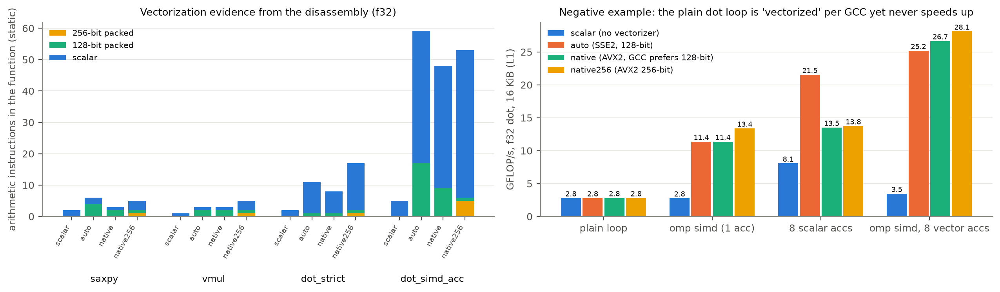
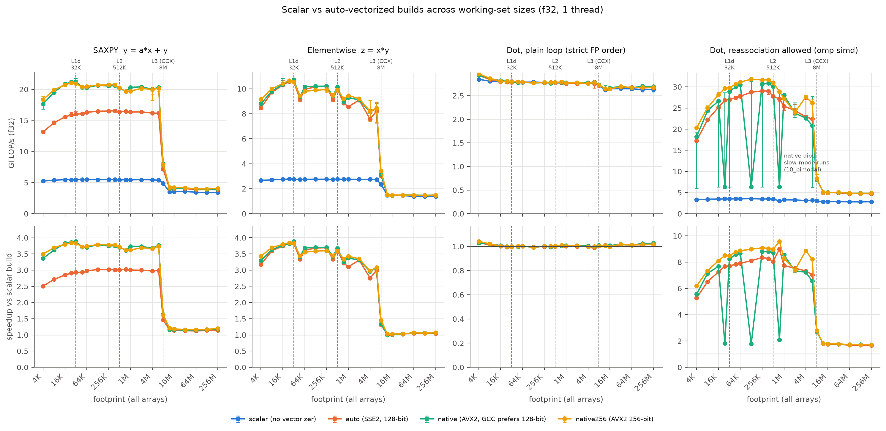
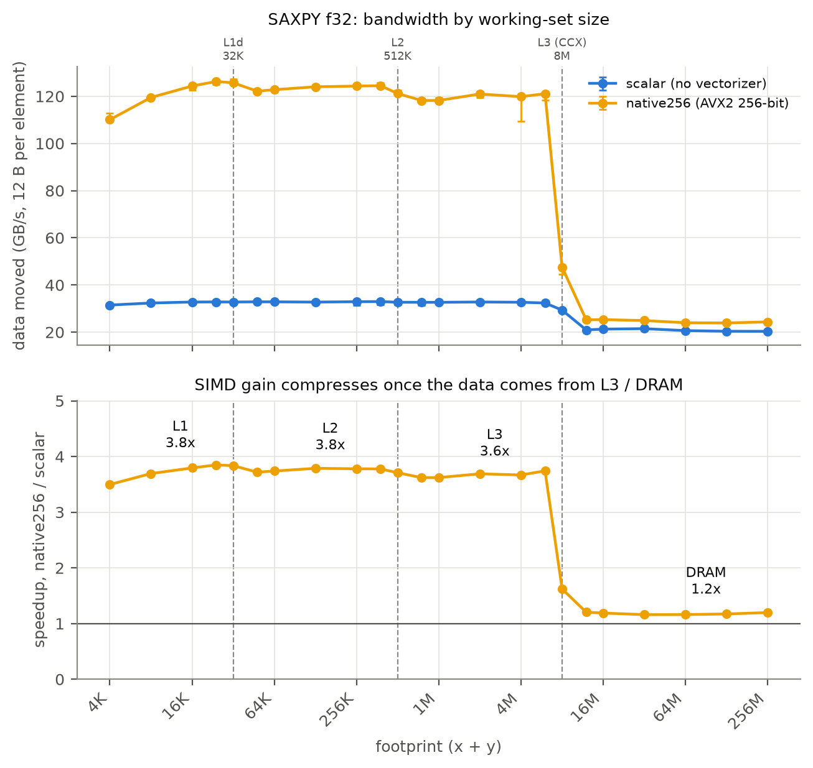
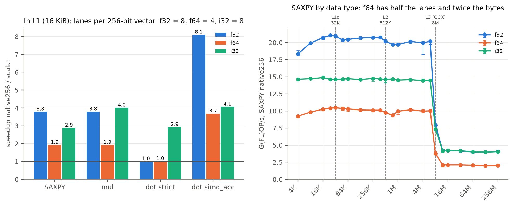
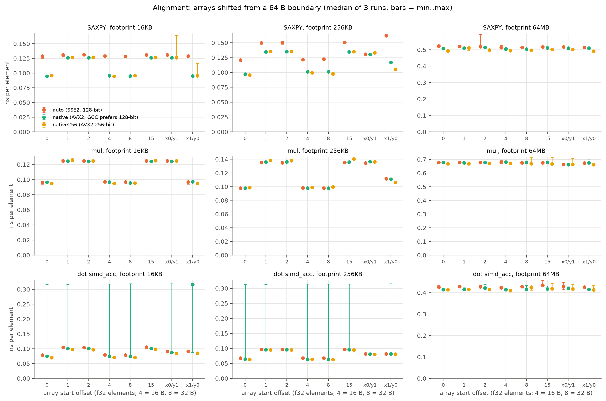
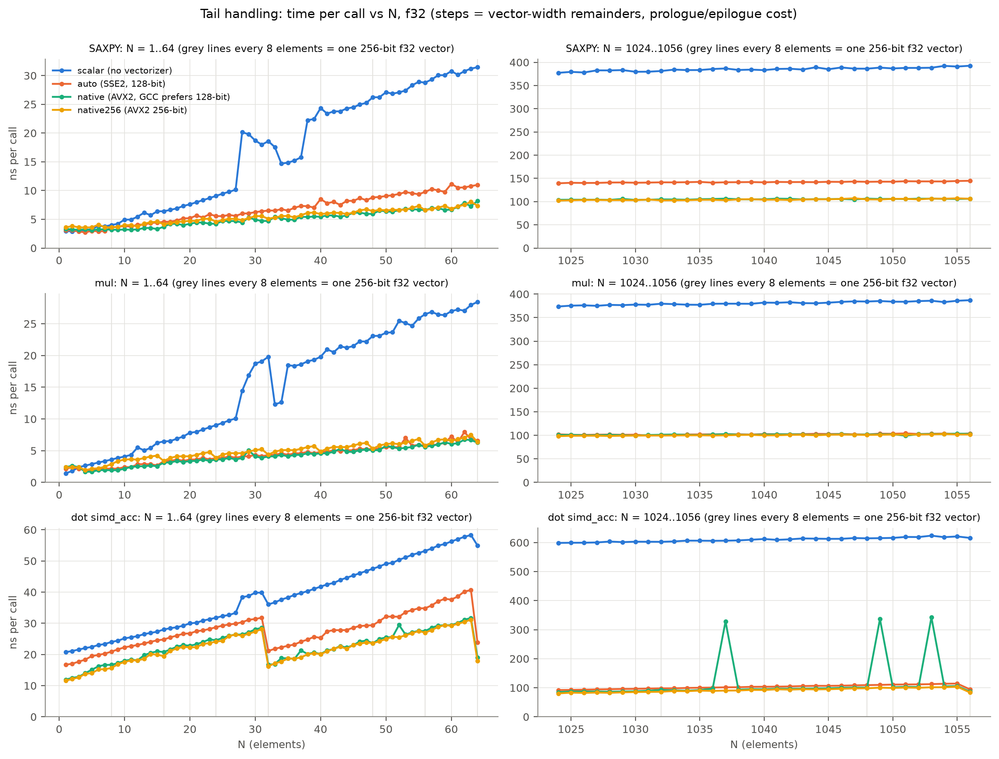
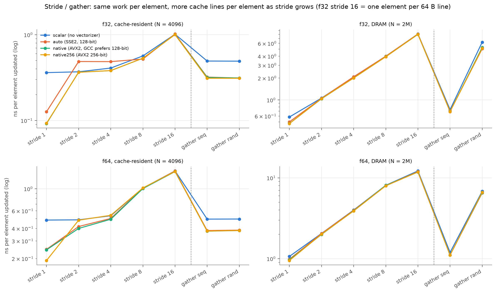
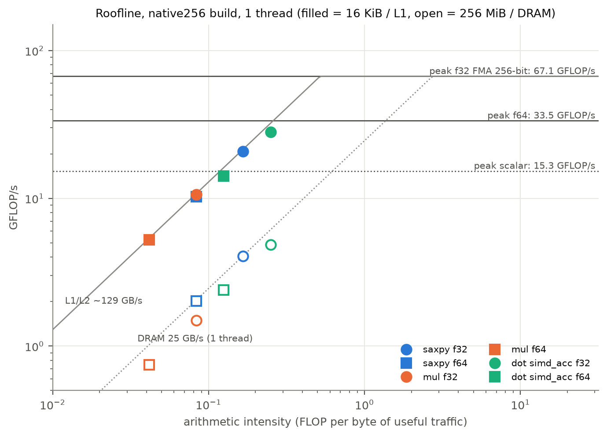
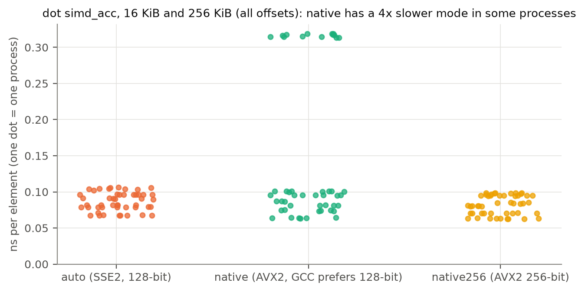

# Project 1 Report: SIMD Advantage Profiling

ECSE 4320/6320 Advanced Computer Systems · Fall 2026

## Summary

I compiled the same three kernels (SAXPY, elementwise multiply and dot product) four times with different flags: scalar-only, default auto-vectorized (SSE2), CPU-native (AVX2, GCC's preferred 128-bit width), and native with 256-bit vectors forced. I timed each build single-threaded on an AMD Threadripper 2920X (Zen+) from a 4 KiB to a 256 MiB footprint.

- **SIMD achieves expected output only while data is in cache -** f32 SAXPY is 3.8× faster than scalar in L1/L2 and 3.6–3.7× in L3, but only 1.2× from DRAM, where every build sits on the same \~24 GB/s memory roof.
- **Every kernel is memory-bound, even in L1 -** Arithmetic intensity is 0.04–0.25 FLOP/byte. The roofline ridge is 0.52 FLOP/byte for L1 and 2.7 for DRAM, against a measured 67 GFLOP/s f32 compute peak.
- **The plain dot product saw no real speedup -** GCC reports the loop as vectorized, yet it runs at the same 2.8 GFLOP/s in all four builds. Strict IEEE ordering keeps a serial chain of floating-point adds, one per 3 cycles. Allowing reassociation (`omp simd` with multiple accumulators) gives up to 9×.
- **Vectorization sometimes makes code slower -** At stride 2 in cache, the SSE2 build is 32% slower than scalar. FMA contraction made the 8-accumulator dot product 37% slower on `native` than on `auto`.
- **256-bit vectors barely help on Zen+ -** The hardware splits them into two 128-bit halves, so `native` and `native256` reach the same peak (67 GFLOP/s f32), and 16-byte alignment is enough even for 256-bit code.

## Rubric map

| Rubric category (points) | Where |
|---|---|
| Baseline, correctness, reproducibility (15) | §2, §3, §9 |
| Vectorization verification (15) | §4.1 |
| Locality and memory-bound analysis (20) | §4.2, §4.3 |
| Alignment, tail, stride/gather studies (20) | §4.5, §4.6, §4.7 |
| Roofline and quantitative insight (20) | §4.8 |
| AI-use transparency and failure case (10) | §5, §8 |
| Report quality (10) | figures throughout, §6, §7, §10 |

---
## 1. Pre-experiment hypotheses

Written before looking at the results:

1. **Speedup should match additional parallel operations -** f32 should approach 4× with 128-bit vectors and 8× with 256-bit. f64 should get about half of that, since it has half the lanes.
2. **Gain significantly drops when leaving cache -** Past the 8 MB L3 of one CCX, the kernels should become DRAM-bandwidth-bound, and all builds should converge.
3. **Data misalignment incurs penalty within cache** (split loads across cache lines) **but not from DRAM.**
4. **Non-unit stride should waste bandwidth in proportion to the stride.** It should also ruin SIMD, because the elements are no longer contiguous.
5. **256-bit vs 128-bit should matter less than expected on Zen+.** The core natively executes 256-bit AVX2 operations as two 128-bit halves.

## 2. System and methodology

| Item | Value |
|---|---|
| CPU | AMD Ryzen Threadripper 2920X (Zen+, `-march=znver1`), 12 cores / 24 threads, SMT on |
| SIMD ISA | SSE2–SSE4.2, AVX, AVX2, FMA3; no AVX-512. 4 FP pipes (2 FMUL/FMA, 2 FADD), 128-bit wide |
| Caches | L1d 32 KB / core, L2 512 KB / core, L3 8 MB per CCX (3 cores) |
| Memory | 64 GB, 4 × DDR4-2133, UMA (one NUMA node) |
| OS | Windows 10 Home 22H2 (10.0.19045) |
| Compiler | g++ 13.1.0 (MSYS2 UCRT64), `-std=c++17 -O3 -g -static` |
| Power plan / hypervisor | Ultimate Performance; Hyper-V hypervisor **off** |
| Measured clock | 4.21 GHz at start, 4.22 GHz at end (dependent-add calibration) |
| Pinning | logical CPU 2, HIGH priority; its SMT sibling (CPU 3) left idle |
| Repetitions | 3 fresh processes × 15 timed trials; each trial is a batch lasting ≥ 2 ms |

**Builds -** The same sources are built four times. Only the flags differ, so any speed difference comes from code generation.

| Build | Extra flags | Vector code |
|---|---|---|
| `scalar` | `-fno-tree-vectorize -fno-tree-slp-vectorize -DBUILD_SCALAR` | none (baseline) |
| `auto` | `-fopenmp-simd` | SSE2, 128-bit, no FMA |
| `native` | `-fopenmp-simd -march=native` | AVX2 + FMA, but GCC's znver1 tuning picks 128-bit |
| `native256` | `-fopenmp-simd -march=native -mprefer-vector-width=256` | AVX2 + FMA, 256-bit |

**Kernels:** `saxpy` (y = a·x + y, plus strided and gather variants), `vmul` (z = x·y), and the dot product in four variants: `strict` (plain loop), `simd` (`omp simd` reduction), `multiacc` (8 scalar accumulators) and `simd_acc` (`omp simd` with 8 vector accumulators). A `peak_flops` kernel of register-only FMA chains sets the roofline ceiling. The kernels are compiled separately and marked `noinline`, so they can't be optimized away or merged into the timing loop.

**Timing:** Each configuration runs in its own process: pin to CPU 2, set up and check the arrays, warm up, then time 15 batches. The reported value is the median of the 15. Plots show the **median of the 3 runs** with min–max error bars, so one process anomaly can't move a point but stays visible (§6).

**Data initialization:** Arrays are filled from a fixed-seed generator with values in [0.5, 1.5), so every process sees identical data with no zeros or denormals. SAXPY alternates between +a and −a on successive calls, so y can't drift or overflow over millions of repetitions.

**Units:** GFLOP/s counts 2 FLOP per element for SAXPY and dot, and 1 for multiply. Bandwidth counts the bytes the kernel must move: 12 B/element for f32 SAXPY and multiply, 8 B for dot. Cycles use the measured clock, never an assumed one.

## 3. Correctness validation

Every run compares its result against a `long double` reference with a stated tolerance. **4,938 of 4,968 baseline rows pass.**

**The 30 failures are float rounding, not bugs -** All of them are f32 dot products at 128–256 MiB in the variants that keep one serial running sum. Once an f32 sum passes 2²⁴ ≈ 16.7 M, adding values near 1 loses bits on every step (1.9–5.1% error). The vectorized variants keep many small partial sums and pass. So **reassociation actually made the result more accurate here.** The failing rows stay flagged in `data/processed/correctness_failures.csv`.

**Sanity checks -** Scalar strict dot runs at exactly **3.0 cycles/element**, the FP-add latency on Zen+, which confirms it is limited by its dependency chain. The measured f32 peak (67.1 GFLOP/s) matches the theoretical 2 FMA pipes × 4 lanes × 2 FLOP × 4.2 GHz = 67.2.

---

## 4. Results

### 4.1 Vectorization verification

Evidence comes from GCC's vectorization reports (`reports/vec_*.txt`, `missed_*.txt`), the assembly per build (`reports/kernels_*.s`), and a count of **arithmetic** instructions by register width (`reports/vector_summary.csv`). Only arithmetic is counted, because scalar code also uses xmm registers.



*Figure 8. Left: static arithmetic instruction mix per kernel and build (f32). Right: GFLOP/s of the four dot-product variants in L1 (16 KiB).*

| Kernel (f32) | scalar | auto | native | native256 |
|---|---|---|---|---|
| saxpy | 2 scalar | 4 × 128-bit | 2 × 128-bit + 3 FMA | 1 × 256-bit + 5 FMA |
| dot_strict | 2 scalar | 1 × 128-bit, **10 scalar** | 1 × 128-bit, 7 scalar | 1 × 256-bit, **15 scalar** |
| dot_simd_acc | 5 scalar | 17 × 128-bit | 9 × 128-bit, 11 FMA | 5 × 256-bit, 7 FMA |

- **Only `native256` uses 256-bit registers -** With plain `-march=native`, GCC deliberately picks 128-bit on Zen+, which is why I added the `native256` build. FMA appears only in the native builds.
- **No build uses a hardware gather instruction -** GCC loads gathered elements one at a time.
- **`dot_strict` is "vectorized" but not really -** It has one packed multiply, but the products are then added one at a time in order (the 10–15 scalar adds), because IEEE rules forbid reordering. Measured speedup: **1.00×** (§5).

### 4.2 Scalar vs auto-vectorized across working-set sizes



*Figure 1. Top: GFLOP/s vs total footprint for each build, f32. Bottom: speedup over the scalar build. Dashed lines: L1d 32 KB, L2 512 KB, L3 8 MB (own CCX).*

Speedup over scalar (`auto` / `native` / `native256`):

| Kernel (f32) | L1 | L2 | L3 | DRAM (256 MiB) |
|---|---|---|---|---|
| SAXPY | 2.85 / 3.83 / 3.79 | 3.01 / 3.75 / 3.78 | 2.97 / 3.68 / 3.67 | 1.14 / 1.17 / **1.20** |
| Multiply | 3.82 / 3.83 / 3.84 | 3.33 / 3.43 / 3.45 | 2.99 / 3.07 / 3.08 | ≈ 1.0 |
| Dot, strict | 1.00 / 1.01 / 1.00 | 1.00 / 1.00 / 1.00 | 1.00 / 1.00 / 1.00 | 1.02 / 1.03 / 1.02 |
| Dot, simd_acc | 7.25 / 7.68 / 8.10 | 8.35 / 8.80 / **9.09** | 7.33 / 7.23 / 8.85 | 1.66 / 1.71 / 1.71 |

- **SAXPY and multiply stay just under 4× in cache -** That is the 4-lane limit of 128-bit f32. The `native` gain over `auto` comes mostly from **FMA**, not width, since `native` is 128-bit as well. Best throughput: 20.7 GFLOP/s (116 GiB/s) in cache, 4.1 GFLOP/s (22.7 GiB/s) from DRAM.
- **The `simd_acc` dot product beats 4× (up to 9×) -** Its scalar baseline is limited by add latency, so vectorizing removes a dependency chain as well as adding lanes.
- **The dips on the green `native` line** are the bimodal slow mode in §6.2.

### 4.3 Locality sweep: where SIMD gains compress



*Figure 2. SAXPY f32 across the cache hierarchy, with the speedup per region annotated.*

SAXPY's speedup is flat at about 3.8× through L1 and L2 and 3.6–3.7× in L3, then **collapses to 1.2× past 8 MB**, the L3 of the core's own CCX. From DRAM, even scalar SAXPY streams \~20 GB/s, close to the \~24.6 GB/s one core can pull from memory, so the vector units just wait on memory. Hypothesis 2 held, with the transition exactly at the CCX L3 size.

### 4.4 Data-type comparison



*Figure 6. Left: native256 speedup over scalar in L1 for each kernel and data type. Right: SAXPY native256 G(FL)OP/s vs footprint for f32, f64 and i32.*

- **f64 gets about half the f32 gain -** (1.96× vs 3.83× for SAXPY), as hypothesis 1 predicted: half the lanes per register. From DRAM it moves twice the bytes, so it delivers half the GFLOP/s at the same bandwidth.
- **i32 depends on the instruction set -** SSE2 has no packed 32-bit integer multiply, so `auto` emulates it and reaches only 2.1×, while `native` reaches 3.1×.
- **The integer dot product vectorizes even in `strict` form (2.9×) -** Integer addition can be reordered, floating-point addition can't. This confirms the cause in §5 is FP rules, not the loop's shape.

### 4.5 Alignment



*Figure 3. ns/element vs array start offset (in 4-byte elements from a 64-byte boundary), for three footprints.*

| Offset, `native` f32 in L2 | SAXPY | Multiply | Dot simd_acc |
|---|---|---|---|
| 0, 16 or 32 B (16-byte aligned) | 0.097–0.101 | 0.098 | 0.064 |
| 4, 8 or 60 B (misaligned) | 0.135 | 0.136 | 0.096 |
| any offset, 64 MB (DRAM) | ≈ 0.51 | ≈ 0.68 | ≈ 0.41 |

- **Breaking 16-byte alignment costs about 30–50% in cache -** Every vector load then straddles two chunks, and some cross a cache line.
- **16-byte alignment is enough, even for 256-bit code -** Zen+ executes a 256-bit load as two 128-bit halves.
- **No effect from DRAM -** All offsets fall within ±2%, as hypothesis 3 predicted. Memory latency hides the cost of a split access.

### 4.6 Tail handling



*Figure 4. Time per call vs N for N = 1–64 and 1024–1056 (every N measured).*

- **Fixed per-call cost dominates small N -** Every build takes about 3 ns per SAXPY call up to N ≈ 8, so SIMD doesn't matter there. `native` breaks even with scalar at N ≈ 5 and is 3.8× faster by N = 64.
- **Leftover elements are expensive for the dot product -** `dot simd_acc` handles 32 floats per loop iteration (`auto`) and does the rest in slow scalar code. **Doing one element less can take 50–70% longer** (N = 31: 31.8 ns vs N = 32: 21.1 ns; N = 63: 40.7 vs N = 64: 23.9).
- **SAXPY has almost no tail penalty -** Its leftover elements are independent and cheap.

### 4.7 Stride and gather



*Figure 5. SAXPY time per element vs stride, and gather with sequential vs random indices, for a cache-resident (N = 4096) and a DRAM-resident (N = 2 M) case.*

| f32, ns per element | In cache: scalar | auto | native | DRAM: native | useful GB/s (DRAM) |
|---|---|---|---|---|---|
| stride 1 | 0.362 | 0.127 | 0.092 | 0.475 | 25.3 |
| stride 2 | 0.370 | **0.487** | 0.366 | 1.04 | 11.6 |
| stride 16 | 1.01 | 1.02 | 1.01 | 7.98 | 1.5 |
| gather, sequential | 0.493 | 0.321 | 0.318 | 0.69 | 23.1 |
| gather, random | 0.492 | 0.313 | 0.313 | **5.28** | 3.0 |

- **From DRAM, time doubles with every stride doubling -** Time follows the number of cache lines touched. The total line traffic stays at the \~24 GB/s DRAM ceiling; only the *useful* fraction falls (25 → 1.5 GB/s).
- **In cache, any stride ≥ 2 erases the SIMD gain -** The elements are no longer contiguous, so building vectors costs as much as the arithmetic saves. Hypothesis 4 held.
- **At stride 2, the SSE2 build is 32% slower than scalar -** SSE2 lacks the shuffle instructions AVX2 has (a second negative example).
- **Random gather from DRAM is 7.6× slower than sequential -** The prefetcher can't follow random indices.

### 4.8 Roofline



*Figure 7. Roofline for the native256 build, one thread. Filled markers: 16 KiB (L1); open: 256 MiB (DRAM).*

**Ceilings (measured):** compute peak 67.1 GFLOP/s f32 and 33.5 f64; bandwidth 128 GB/s from L1/L2 and **24.6 GB/s from DRAM** for one core.

| Kernel | FLOP/elem | Bytes/elem (f32) | Arithmetic intensity (f32) |
|---|---|---|---|
| SAXPY | 2 | 12 | 0.167 |
| Multiply | 1 | 12 | 0.083 |
| Dot | 2 | 8 | 0.250 |

**Ridge points:** 67 / 128 = **0.52 FLOP/B** in cache, 67 / 24.6 = **2.7 FLOP/B** from DRAM. Every kernel is far below both, so **all are memory-bound at every footprint**, even in L1.

| Point (native256, f32) | Measured GFLOP/s | Roof | % of roof |
|---|---|---|---|
| SAXPY, L1 / DRAM | 20.7 / 4.06 | 21.4 / 4.09 | 97% / **99%** |
| Multiply, L1 / DRAM | 10.6 / 1.49 | 10.7 / 2.05 | 99% / **73%** |
| Dot simd_acc, L1 / DRAM | 28.1 / 4.85 | 32.1 / 6.14 | 88% / **79%** |

- **Multiply reaches only 73% from DRAM because of write-allocate -** Writing z first reads each line into cache, so 16 B really move per element instead of 12; 12/16 = 75%. SAXPY avoids this because it already reads y.
- **The dot product reaches 79% -** It only reads, and one core's read-only stream peaks near 19 GB/s, consistent with Project 2's single-thread measurements.

**Conclusion -** For these kernels, SIMD is limited by memory bandwidth, not vector width. Only code with much higher arithmetic intensity could use the 67 GFLOP/s peak.

---

## 5. Negative and misleading examples

1. **A loop that looks vectorized but isn't faster -** For the plain dot product, GCC reports "loop vectorized" in every vector build, but the assembly adds the products one at a time and the speedup is 1.00× at every size. A benchmark that trusted the compiler report would wrongly call this SIMD.
2. **A loop that vectorizes but can't speed up -** SAXPY from DRAM: all four builds land within 20% of each other on the 24.6 GB/s roof.
3. **Vectorization that makes code slower -** SSE2 at stride 2 is 32% slower than scalar. On `native`, the 8-accumulator dot product runs at 13.5 GFLOP/s vs 21.5 on `auto`, because GCC fuses each multiply-add into an FMA and the chain then waits on FMA latency (5 cycles) instead of add latency (3). Predicted ratio 0.60, measured **0.63**.

## 6. Anomalies

### 6.1 Correctness failures in large f32 sums
See §3: rounding in the serial f32 sum. The vectorized code is the more accurate one.

### 6.2 Bimodal slow mode in `native` dot simd_acc



*Figure 10. Per-process ns/element for `dot simd_acc`; the native build forms two separate clusters.*

In some processes (about a quarter of the `native` points in Figure 10), `dot_simd_acc` runs **4× slower**. All 15 trials within a process agree, so the state is fixed when the process starts. Neither `auto` nor `native256` shows it. The slow speed matches the 8 accumulator chains running one after another instead of overlapping.

**Ruled out:** input data (fixed seed), array alignment (appears at every offset), stack placement (accumulators are in registers) and clock speed (the slowdown shows in cycles). **Still unexplained.** It also causes the spikes at N = 1037, 1049 and 1053 in Figure 4. Medians of 3 runs keep it from driving the trends, and the min–max bars keep it visible.

### 6.3 Other anomalies
- **Scalar time per call doubles at N = 28 -** In Figure 4, scalar SAXPY and multiply jump from \~10 to \~20 ns at N = 28, then dip at N = 33–37. It repeats in all 3 runs. My guess is a change of code path in the scalar loop at that trip count; I didn't verify it.
- **Native vs native256 differ by at most 5% -** As hypothesis 5 predicted, forcing 256-bit gives little on Zen+.

## 7. Design process: discoveries and pitfalls

- **"Widest vectors" needed a fourth build -** I expected `-march=native` to use 256-bit registers; the instruction counts showed it didn't, so `native256` was added.
- **Using xmm registers is not evidence of SIMD -** Scalar FP code uses them too, so the verification counts only packed arithmetic.
- **Timing tiny calls -** Calls of a few nanoseconds are batched so each timed batch lasts ≥ 2 ms.
- **Keeping the compiler honest -** Kernels are compiled separately, results go to a `volatile` sink, and link-time optimization is off, so the timed work can't be deleted.
- **Toolchain -** The project started with a Makefile and bash scripts, then moved to PowerShell to match Projects 2 and 3. The executables are linked `-static` so they run without MSYS2 on `PATH`.

## 8. AI-use note

**Tool.** Claude Code (Anthropic's AI coding assistant, running in VS Code).

**What it generated:**
- the extended kernels (`saxpy`, `saxpy_stride`, `saxpy_gather`, `vmul`, `peak_flops`, long-double references), building on my existing dot-product code;
- the `bench.cpp` harness flags;
- the PowerShell build and run scripts (`build.ps1`, `run_all.ps1`, `tools/vec_summary.ps1`);
- the plotting script `plots/make_plots.py`;
- first draft of project README;
- polished report and translated to a markdown file as I am unfamiliar with the syntax.

**What I did and decided:**
- worked out the approach with Tiffany Cheng and Marie Morales;
- wrote upper-level design for the project that Claude implemented;
- performed operations that required administrator privileges (turning hypervisor off);
- ran the full data collection (3 runs) myself;
- analyzed and interpreted data from the operations and wrote the initial report.

**AI mistakes and wrong turns, and how they were caught:**

| # | What went wrong | How it was caught / fixed |
|---|---|---|
| 1 | The generated Makefile chose binary names without `.exe`, so the vectorization summary came out empty | Noticed from the empty output; fixed, and later replaced by `build.ps1` |
| 2 | The scripts first assumed bash/MSYS2, which didn't match the rest of the project | I asked for PowerShell; the scripts were rewritten and checked to give identical output |
| 3 | The executables needed MSYS2's runtime libraries and failed from a plain PowerShell window | `-static` added to every build |
| 4 | **Overstated claim:** GCC's "loop vectorized" message was first taken at face value for `dot_strict` | Measured 1.00× speedup and checked the assembly; now the main negative example (§5) |
| 5 | **Verification-tool bug:** `vec_summary.ps1` doesn't recognize the instruction SSE2 uses for integer multiply, so it labels `auto`'s integer multiply "scalar" although it runs 2.3× faster | Checked against the assembly; all other counts are unaffected |
| 6 | **A find-and-replace during repository cleanup corrupted `tools/vec_summary.ps1`** (every `-` became `B`) | Spotted immediately; restored, and verified by regenerating `vector_summary.csv` byte-identical |

**What I validated independently:**
- every number in this report against `data/processed/`;
- the assembly for the negative example and the integer-multiply case.

## 9. Reproducibility

```powershell
powershell -ExecutionPolicy Bypass -File .\build.ps1          # 4 builds -> bin\
powershell -ExecutionPolicy Bypass -File .\run_all.ps1        # all experiments -> data\raw\, reports\
py -3.12 plots\make_plots.py                                  # data\processed\ + plots\
```

Raw data is in `data/raw/`, processed tables in `data/processed/`, and vectorization evidence in `reports/`. A full run takes about 30 minutes.

## 10. Limitations

- **Static instruction counts, not dynamic -** They show what the compiler emitted, not how often each instruction ran. Hardware counters (used in Project 2) weren't used here.
- **One compiler (GCC 13.1) and one machine -** Clang might vectorize the strided and gather cases differently, and the DRAM ceiling is one core's limit, not the chip's.
- **The bimodal slow mode is unexplained.**
- **Memory traffic is calculated, not measured -** Write-allocate in §4.8 is inferred, not counted.

## 11. Conclusions

1. **SIMD gives close to lane-count speedups in cache** (3.8× for f32) **and almost nothing from DRAM** (1.2×). The transition is at the 8 MB CCX L3.
2. **Arithmetic intensity determines outcome.** At 0.04–0.25 FLOP/B, these kernels are memory-bound everywhere; the 67 GFLOP/s peak is unreachable for them.
3. **Compiler reports are not proof.** A "vectorized" loop with a serial FP reduction gets 1.0×. Permitting reassociation resulted in the largest improvement (9×) and also improves accuracy.
4. **Wider data is not automatically better.** On Zen+, 256-bit matches 128-bit, 16-byte alignment is sufficient, and both stride-2 SSE2 code and FMA contraction can slow code down.
