# Project 2 Report: Cache & Memory Performance Profiling

ECSE 4320/6320 Advanced Computer Systems · Fall 2026

## Summary

I measured each level of the memory hierarchy of an AMD Threadripper 2920X (Zen+) under Windows 10, with one purpose-built C++ benchmark per experiment and hardware counters read through AMD uProf's PCM tool.

- **Latency climbs steeply down the hierarchy -** 4 / 12 / 34 / 505 cycles (0.95 / 2.87 / 8.1 / 121 ns) for L1 / L2 / L3 / DRAM on 2 MB pages. On 4 KB pages the DRAM number almost doubles to 218 ns, because every access also needs a page walk.
- **Throughput needs many requests in flight -** One core saturates at about **24 misses in flight** (10.2 GB/s, Little's Law). The whole chip reaches \~50 GB/s with \~141 in flight, about 78% of the theoretical DDR4 peak.
- **Page walks can cripple concurrency -** With 4 KB pages over 1 GB, one core manages only **6 misses in flight and 1.4 GB/s**. 2 MB pages remove the problem.
- **Counters explain the runtime -** As the footprint grows, misses move from L2 to L3 to DRAM and runtime steps up at each move. Every page walk shows up as exactly one extra L2 miss.
- **Naive benchmarks mislead by large factors -** Re-reading a cached buffer reports 5× the real DRAM bandwidth, a sequential pointer chain reports 1/37 of the real latency, and threads stuck on one CPU lose 68% of the bandwidth.

## Rubric map

| Rubric category (points) | Where |
|---|---|
| Zero-queue baselines (25) | §3 |
| Pattern / granularity / RW sweeps (35) | §4 |
| Throughput–latency knee (35) | §5 |
| Working-set / cache / TLB analysis (35) | §6, §7, §8 |
| Experimental rigor (25) | §2, §12 |
| AI-use transparency and pitfall analysis (15) | §9, §11 |
| Report quality (15) | figures throughout, §10, §13, §14 |

---
## 1. Pre-experiment hypotheses

1. **Latency should step up at each cache size -** 32 KB (L1), 512 KB (L2) and 8 MB (the L3 of one CCX, not the chip's 32 MB). I expected roughly 4 / 12 / 35–40 cycles and 80–100 ns for DRAM.
2. **Random access should be much slower than sequential -** The prefetchers can predict sequential addresses but not random ones.
3. **Writes should cost more bandwidth than reads -** A write to a line not in cache first reads the line, then later writes it back.
4. **Throughput should rise with outstanding requests until a limit, then only latency should grow -** a knee.
5. **TLB misses should matter only past TLB reach** (256 KB for L1, 6 MB for L2 with 4 KB pages), and 2 MB pages should remove that cost.

## 2. System and methodology

| Item | Value |
|---|---|
| CPU | AMD Ryzen Threadripper 2920X (Zen+), 12 cores / 24 threads, SMT on; 4 CCXs of 3 cores |
| Caches | L1d 32 KB / core, L2 512 KB / core, L3 8 MB per CCX (32 MB total), 64 B lines |
| Memory | 64 GB, 4 × DDR4-2133 (68.3 GB/s theoretical), UMA mode (one NUMA node) |
| OS | Windows 10 Home 22H2 (10.0.19045) |
| Compiler | g++ 13.1.0 (MSYS2 UCRT64), `-O2 -std=c++20 -static` |
| Counters | AMD uProf 5.3.521, AMDuProfPcm in counting mode |
| Power plan / clock | Ultimate Performance; 4.14–4.23 GHz, measured before and after every run |
| Hypervisor | **off** for the main data set (`data/raw/`); a hypervisor-**on** set is kept in `data/hv_on/` (§10) |
| Pages | 4 KB by default; 2 MB large pages where tested |

**Pinning:** The measuring thread runs on logical CPU 2 at HIGH priority with its SMT sibling idle. Worker threads for bandwidth tests get one physical core each.

**Repetitions:** Every experiment runs **3 times as fresh processes**, with buffers rebuilt and reshuffled each time. Plots show the mean with ±1 sd error bars.

**Latency method:** A dependent pointer chase (`p = *p`) through a random cycle with one node per 64 B line. Only one miss is in flight, and the prefetchers can't predict the next address.

**Bandwidth method:** Streaming reads and writes from 1–10 threads.

**Sanity checks:** Every chain is verified to visit every node. The SAXPY result is checked against a reference loop. L1 latency comes out at exactly **4.0 cycles**, Zen's documented value, so the timing loop is measuring real loads. Every result feeds a printed value so the compiler can't delete the loops.

## 3. Zero-queue latency

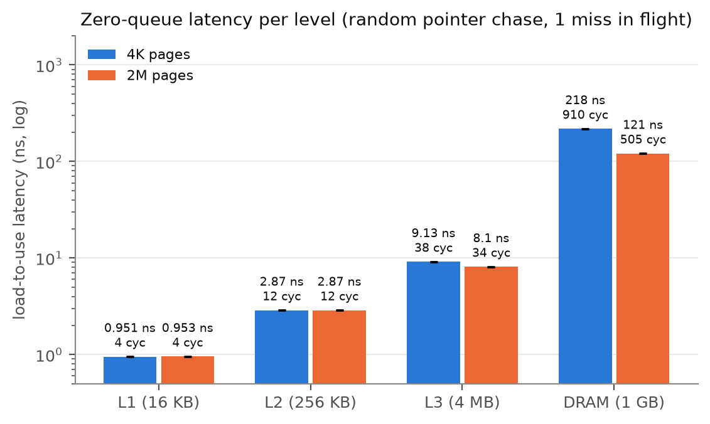

*Figure 1. Load-to-use latency per level (random pointer chase, one miss in flight), 4 KB vs 2 MB pages.*

| Level (test size) | 4 KB pages | 2 MB pages | Cycles (4K / 2M) |
|---|---|---|---|
| L1 (16 KB) | 0.95 ns | 0.95 ns | 4 / 4 |
| L2 (256 KB) | 2.87 ns | 2.87 ns | 12 / 12 |
| L3 (4 MB) | 9.13 ns | 8.10 ns | 38 / 34 |
| DRAM (1 GB) | 217.8 ns | **120.9 ns** | 910 / 505 |

- **The 2 MB number is the true DRAM latency -** With 4 KB pages, 1 GB spans 262,144 pages, far beyond the TLB, so every access also needs a page walk. The 97 ns difference is address translation (§8).
- **DRAM is slower than I guessed -** 121 ns instead of 80–100 ns. About half the accesses go to the other die's memory controller, which adds latency.

## 4. Pattern, granularity and read/write sweeps

### 4.1 Pattern and stride

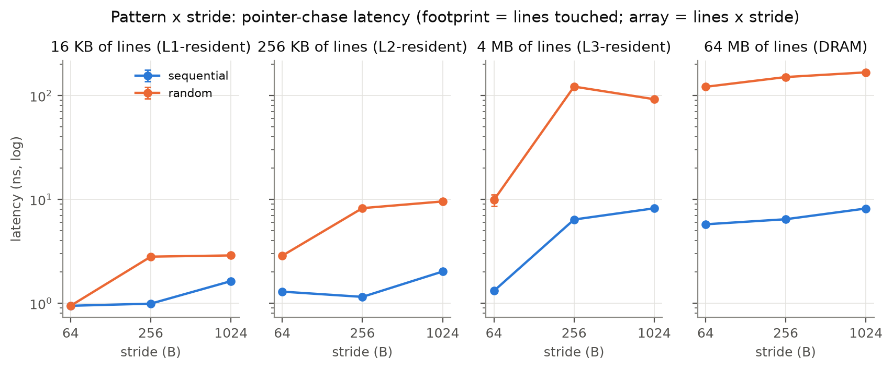

*Figure 2a. Latency for sequential vs random order at strides of 64/256/1024 B, for four footprints (bytes of lines actually touched).*

| Footprint, random order | 64 B stride | 256 B | 1024 B |
|---|---|---|---|
| 16 KB | 0.94 ns | **2.81** | 2.89 |
| 256 KB | 2.87 | **8.24** | 9.55 |
| 4 MB | 9.87 | **122.1** | 92.3 |
| 64 MB | 121.5 | 150.9 | 167.4 |

- **Sequential stays fast at every size -** 5.8 ns per access from DRAM vs 121 ns random, because the prefetchers run ahead. Hypothesis 2 held.
- **Large strides cause cache-set conflicts -** A 256 B stride uses only ¼ of each cache's sets, so the usable capacity shrinks to ¼. That's why 16 KB falls out of L1, 256 KB out of L2, and 4 MB out of L3 at 256 B stride, even though each would fit by size.
- **Anomaly -** At 4 MB, the 1024 B stride (92 ns) is faster than 256 B (122 ns), the opposite of what the simple set model predicts. Zen's L3 likely spreads addresses with a hash; I didn't verify this.

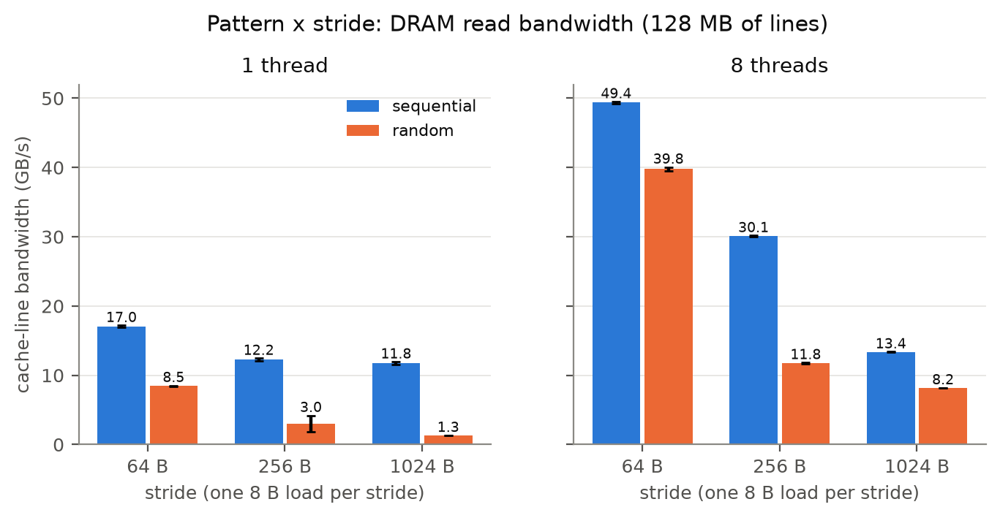

*Figure 2b. Read bandwidth, sequential vs random, at 64/256/1024 B strides, with 1 and 8 threads.*

- **Random access halves single-thread bandwidth -** 17.0 GB/s sequential vs 8.5 GB/s random (64 B stride, 1 thread). With 8 threads the gap narrows (49 vs 40 GB/s) because more misses overlap.

### 4.2 Access granularity

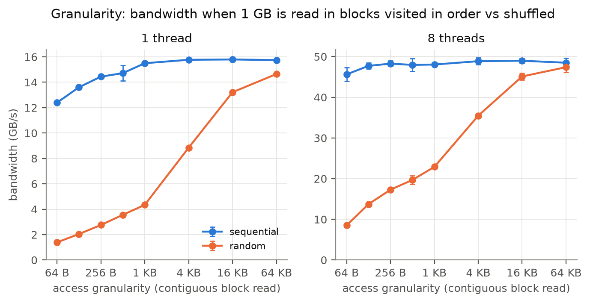

*Figure 2c. Random accesses to contiguous blocks of 64 B to 64 KB, 1 vs 8 threads.*

**Random blocks have to be large to approach sequential speed -** With one thread, 64 B blocks reach 1.4 GB/s, 4 KB blocks 8.8 GB/s, and 64 KB blocks 14.7 GB/s (sequential: 15.8). Each new random block pays a full latency and restarts the prefetcher.

### 4.3 Read/write mix

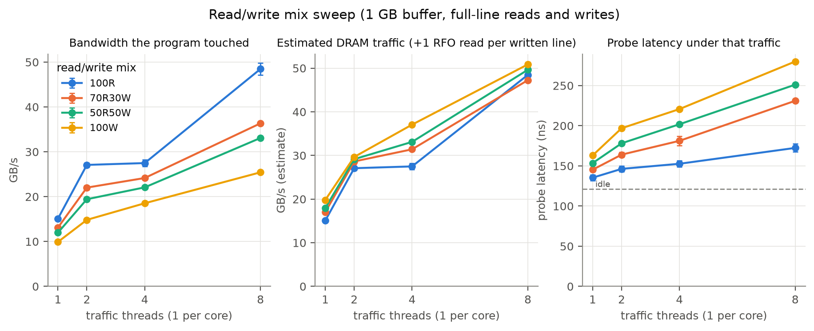

*Figure 3. Throughput and loaded latency (measured by a separate probe thread) for 100% read, 70/30, 50/50 and 100% write.*

| Mix (8 threads) | Useful bandwidth | Est. DRAM traffic | Probe latency |
|---|---|---|---|
| 100% read | 48.5 GB/s | 48.5 GB/s | 172 ns |
| 70R / 30W | 36.4 | 47.3 | 231 ns |
| 50R / 50W | 33.1 | 49.6 | 251 ns |
| 100% write | 25.4 | 50.9 | **280 ns** |

- **Writes halve useful bandwidth but not DRAM traffic -** Each written line is read first and written back later, so DRAM moves twice the data. Counting that, every mix moves about 50 GB/s. Hypothesis 3 held. (The ×2 factor is an estimate, not a counter reading.)
- **Latency rises with the write fraction -** from 172 to 280 ns at the same DRAM traffic, because writebacks delay the reads.

## 5. Intensity sweep: knee and Little's Law

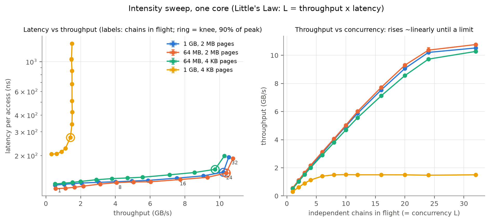

*Figure 4a. One core with K independent random chains. Left: latency vs throughput (ring = knee). Right: throughput vs chains in flight.*

**Knee definition:** the first point that reaches 90% of peak throughput.

| Configuration | Knee | Throughput | Latency | Little's Law: in flight |
|---|---|---|---|---|
| 1 GB, 2 MB pages | 24 chains | 10.2 GB/s | 150 ns | 10.2 GB/s ÷ 64 B × 150 ns = **24** |
| 64 MB, 2 MB pages | 24 | 10.4 GB/s | 148 ns | 24 |
| 64 MB, 4 KB pages | 24 | 9.7 GB/s | 158 ns | 24 |
| **1 GB, 4 KB pages** | **6** | **1.4 GB/s** | 273 ns | **6** |

- **Below the knee, throughput grows linearly and latency barely moves -** 120 → 150 ns from 1 to 24 chains.
- **Past the knee, only latency grows -** At 32 chains, +30% latency buys +3% throughput. The limit is the number of misses one core can track (about two dozen), so one core can use only \~15% of the chip's bandwidth. Hypothesis 4 held.
- **4 KB pages at 1 GB hit a different wall -** Every access needs a page walk, the walks themselves miss in cache, and the core can only run a couple at once. Concurrency stops helping at 6 chains. Same buffer, same chains; only the page size changed. This was the most striking result of the project.

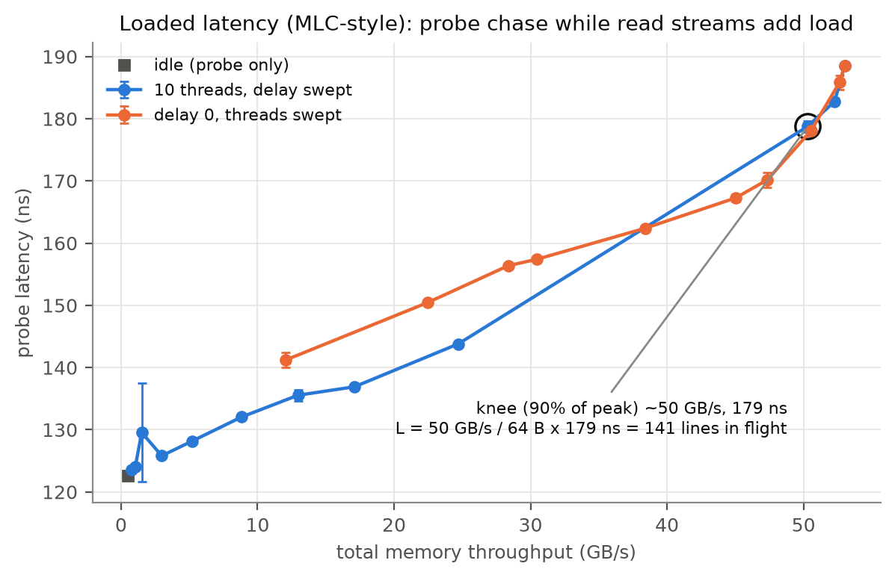

*Figure 4b. Loaded latency vs total bandwidth with 10 streaming threads, in the style of Intel MLC's loaded-latency test.*

**Whole-chip knee -** Latency rises from 123 to **179 ns** as bandwidth reaches **\~50 GB/s**, so about 50 GB/s ÷ 64 B × 179 ns ≈ **141 lines in flight**. The peak of \~53 GB/s is **78% of the 68.3 GB/s theoretical**; refresh and read/write turnarounds take the rest.

## 6. Working-set sweep

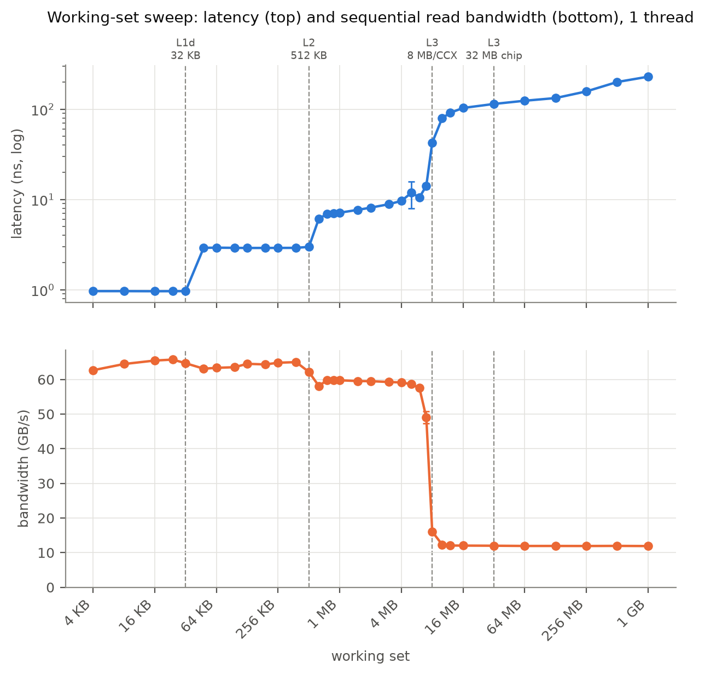

*Figure 5. Random-chase latency (top) and single-thread sequential bandwidth (bottom) vs working set, with cache sizes marked.*

| Working set | Latency | Level |
|---|---|---|
| ≤ 32 KB | 0.96 ns (4 cycles) | L1 |
| 64–512 KB | 2.9 ns (12 cycles) | L2 |
| 1–6 MB | 6–11 ns | L3 (own CCX) |
| 16 MB | 103 ns | DRAM |
| 1 GB (4 KB pages) | 229 ns | DRAM + page walks |

- **The last cache edge is at 8 MB, not 32 MB -** A core only uses its own CCX's L3. Hypothesis 1 held.
- **Sequential bandwidth -** \~65 GB/s in L1/L2, \~59 GB/s in L3, 11.9 GB/s from DRAM (one thread).
- **DRAM latency keeps rising past 16 MB -** The page walks start missing in cache too.

## 7. Cache-miss impact, with counters

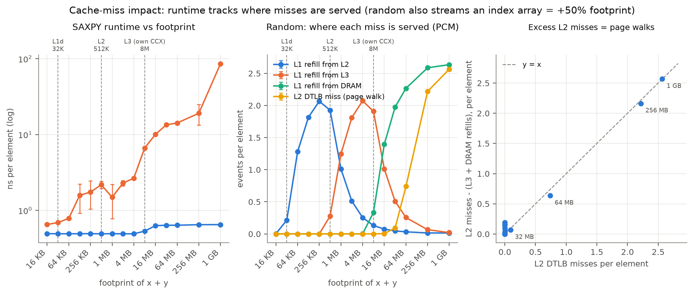

*Figure 6. SAXPY, sequential vs random order. Left: runtime vs footprint. Middle: where each miss is served from (PCM counters). Right: extra L2 misses vs page walks.*

**Method:** AMDuProfPcm counted events on CPU 2 only while the kernel ran (the program signals when setup is done). Events: instructions, cycles, cache refills by source (L2 / L3 / DRAM), L2 misses, and TLB misses.

| Random SAXPY, per element | ns | from L2 | from L3 | from DRAM | L2 TLB miss |
|---|---|---|---|---|---|
| 64 KB | 0.78 | 1.28 | – | – | – |
| 4 MB | 2.71 | 0.26 | 2.07 | 0.002 | – |
| 16 MB | 9.5 | 0.08 | 1.01 | 1.40 | 0.01 |
| 256 MB | 15.9 | 0.02 | 0.07 | 2.59 | 2.22 |
| 1 GB | 85.4 | 0.02 | 0.02 | 2.64 | 2.57 |

- **Runtime tracks where misses are served -** Misses move from L2 to L3 between 512 KB and 1 MB, and from L3 to DRAM between 8 and 16 MB, and runtime steps up at both points.
- **Each page walk adds one L2 miss -** After subtracting the misses served by L3 and DRAM, the remaining L2 misses equal the TLB misses almost exactly (e.g. 2.56 vs 2.57 at 1 GB). That independent check shows the counters measure what we think.
- **The 1 GB cliff is the cost of each walk, not the number of misses -** From 256 MB to 1 GB the miss counts barely change, but runtime jumps 5×. At 1 GB the page tables no longer fit in cache, so each walk becomes a DRAM access itself.
- **Sequential order shows almost no misses even at 1 GB -** The prefetchers fetch every line before the program asks for it, so miss counters make streaming code look cache-resident. Counters must be read together with runtime.

**AMAT check -** The textbook formula multiplies each level's miss count by its latency. At 16 MB that predicts 0.08 × 2.9 + 1.01 × 9.1 + 1.40 × 121 ≈ **179 ns** per element, but the measurement is **9.5 ns**. About **19 misses overlap**, which matches the \~24-miss per-core limit in §5. AMAT assumes one miss at a time; Little's Law supplies the missing factor.

*Note: the footprint axis counts x + y only. Random SAXPY also reads an index array (+50%), so the transitions sit a bit to the left of the labels.*

## 8. TLB-miss impact and huge pages

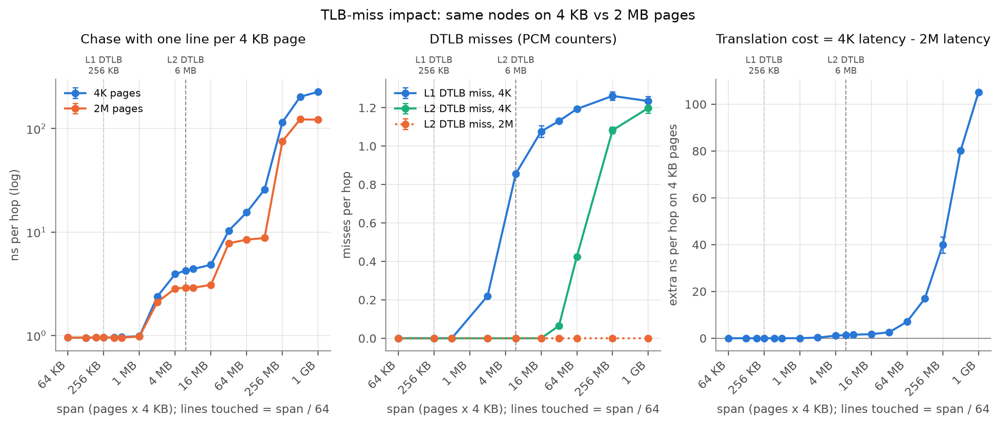

*Figure 7a. Chase with one line per 4 KB page, on 4 KB vs 2 MB pages (same layout). Left: time per access. Middle: TLB misses (PCM). Right: translation cost (4K minus 2M).*

**Design:** The same nodes on 4 KB or 2 MB pages, so the cache footprint is identical and any difference is address translation.

| Span | 4 KB pages | 2 MB pages | L1 TLB miss / access | L2 TLB miss / access |
|---|---|---|---|---|
| 1 MB | 0.98 ns | 0.98 ns | 0 | 0 |
| 16 MB | 4.82 ns | 3.08 ns | 1.08 | 0 |
| 64 MB | 15.5 ns | 8.43 ns | 1.19 | 0.43 |
| 1 GB | **226.9 ns** | **121.8 ns** | 1.23 | **1.20** |

- **TLB reach is about 4× the listed size -** L1 TLB misses start between 1 and 2 MB (listed reach 256 KB), and L2 TLB misses between 16 and 32 MB (listed 6 MB). That fits Zen's ability to merge 4 neighbouring pages into one TLB entry. I can't confirm the physical page layout from a normal program, so this is a well-supported hypothesis.
- **At 1 GB, translation costs 105 ns per access -** 1.2 TLB misses per access on 4 KB pages vs none on 2 MB, with the same DRAM traffic. **Huge pages remove the walk entirely.** Hypothesis 5 held, apart from the larger reach.

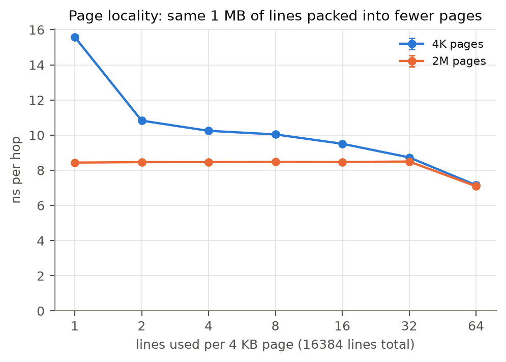

*Figure 7b. 1 MB of lines packed 1–64 lines per 4 KB page.*

**Packing data densely gives most of the huge-page benefit -** On 4 KB pages, latency falls from 15.6 ns (1 line per page) to 7.2 ns (64 lines per page), while 2 MB pages stay near 8.4 ns.

## 9. Benchmark pitfalls

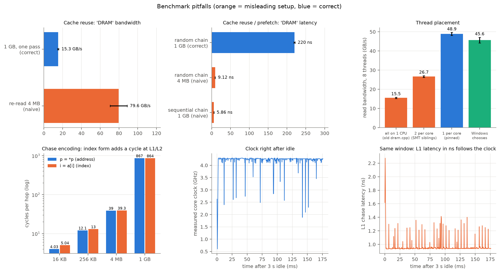

*Figure 8. Misleading setups (orange) vs correct measurements (blue), Windows' own thread placement (green), and the clock right after idle.*

| Pitfall | Naive result | Correct result | Error |
|---|---|---|---|
| Re-reading a 4 MB buffer as "DRAM bandwidth" | 79.6 GB/s | 15.3 GB/s (1 GB, one pass) | 5.2× too high |
| Sequential chain as "DRAM latency" | 5.9 ns | 219.9 ns (random chain) | 37× too low |
| 4 MB chain as "DRAM latency" (cache reuse) | 9.1 ns | 219.9 ns | 24× too low |
| 8 threads all on one CPU (process-wide affinity mask) | 15.5 GB/s | 48.9 GB/s (1 per core) | 68% lost |
| 8 threads on 4 cores (SMT siblings) | 26.7 GB/s | 48.9 GB/s | 45% lost |
| Index chase `i = a[i]` instead of `p = *p` | 5.0 cycles at L1 | 4.0 cycles | +1 cycle |
| No warm-up after idle | first sample 0.6–2.6 GHz | 4.2 GHz within \~1 ms | first ms distorted |

- **The pinning pitfall is easy to hit by accident -** Setting one affinity mask for the whole process puts all "parallel" threads on one CPU. The program still runs and reports a plausible number.
- **Windows' own placement (45.6 GB/s) nearly matches explicit pinning -** The scheduler spreads threads well; pinning mattered more for *measuring* consistently.
- **The clock ramp is short -** about 1 ms under this power plan, so it only distorts benchmarks with no warm-up.

## 10. Anomalies

### 10.1 Bimodal random SAXPY at small footprints

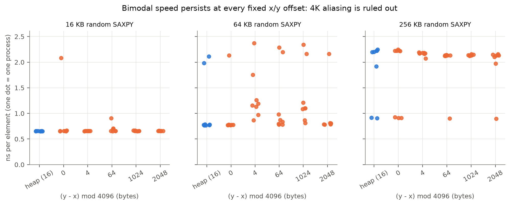

*Figure 9. Random SAXPY at 16/64/256 KB across fresh processes, with natural and forced array placements.*

Each process runs at one of two speeds, \~0.7–0.9 or \~2.2 ns per element, with the same instruction and miss counts. **First hypothesis, 4K aliasing** (a load falsely appearing to depend on a store with matching low address bits)**, was tested and rejected:** forcing five different array offsets still produced both speeds. The state is fixed per process; the cause is still open. I report means ± sd rather than dropping runs.

### 10.2 Hypervisor on vs off

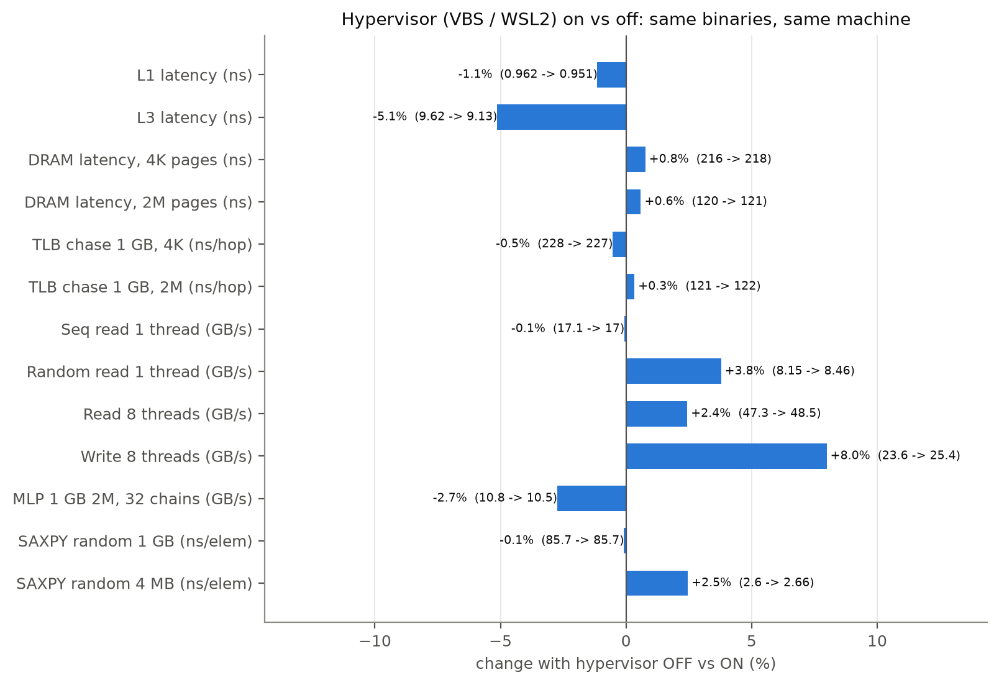

*Figure 10. Change in 13 key metrics between the hypervisor-on and hypervisor-off data sets.*

The first full data set was collected with Hyper-V running. That blocked the hardware counters completely, so the hypervisor was turned off and everything was rerun. **Every metric moved by less than 8%, and DRAM latency by under 1%.** The hypervisor's real effect was blocking the counters, not slowing memory. The first explanation offered for the high 4 KB DRAM latency (extra translation under the hypervisor) was wrong; it is the program's own page walks, as the 2 MB data shows.

### 10.3 Smaller anomalies
- **1024 B stride faster than 256 B at 4 MB** (§4.1).
- **Slightly more than 1 L1 TLB miss per access** (1.2–1.3) with one load per access. The counter probably also counts retried lookups.
- **Bandwidth barely grows from 2 to 4 threads** (27.1 → 27.5 GB/s), then jumps at 8. Threads 1–4 all sit on the first die, so I suspect one die's link is the limit; untested.

## 11. Design process and AI-use note

### 11.1 How the design evolved
- **One program per experiment -** Nine single-purpose programs share one header with the pinning, timing, buffer and thread code.
- **Large pages on Windows Home -** The usual settings tool doesn't exist there, so a small helper grants the "Lock pages in memory" right once.
- **Page size had to become an explicit setting -** Once large pages worked, the concurrency test silently switched to 2 MB pages and the 4 KB result disappeared. Both sizes are now run.
- **Hardware counters -** They were unavailable until the hypervisor was off. uProf's sampling mode produced empty reports, so the final approach uses its counting tool (AMDuProfPcm), started when the program signals setup is done, with a custom event list.

### 11.2 AI-use note

**Tool.** Claude Code (Anthropic's AI coding assistant, running in VS Code).

**What it generated:**
- the nine benchmark programs and `common.h`, from my upper-level design;
- the build and run scripts, and the PCM counter scripts;
- the alias-check script and the large-page helper;
- the plotting script `plots/make_plots.py`;
- first draft of project README;
- polished report and translated to a markdown file as I am unfamiliar with the syntax.

**What I did and decided:**
- worked out the approach with Tiffany Cheng and Marie Morales;
- wrote upper-level design for the project that Claude implemented;
- performed operations that required administrator privileges (granting the large-page right, turning hypervisor off);
- ran the full data collection myself (hypervisor on and off, the counter runs and the alias check);
- analyzed and interpreted data from the operations and wrote the initial report.

**AI mistakes and wrong turns, and how they were caught:**

| # | What went wrong | How it was caught / fixed |
|---|---|---|
| 1 | **Timing bug:** the one-CPU pinning test reported infinite bandwidth, because threads finished before the start time was recorded | Caught in the first test run; each thread now records its own start and end |
| 2 | **Wrong setup instructions:** the README said to use `secpol.msc` and an admin shell for large pages | That tool doesn't exist on Windows Home; a helper was written, and testing showed admin isn't needed |
| 3 | **Guessed tool options:** the first uProf script used unverified options, and its sampling mode gave empty reports | Replaced with the PCM counting tool after checking the real help output |
| 4 | **Wrong claim:** "the hypervisor inflates DRAM latency" | Disproved by my hypervisor-off rerun (< 1% change) |
| 5 | **Wrong claim:** "no frequency ramp under this power plan" | Finer-grained data showed a \~1 ms ramp |
| 6 | **Wrong hypothesis:** 4K aliasing as the cause of the bimodal SAXPY | Tested with forced offsets and rejected (§10.1) |
| 7 | **Silently lost experiment:** enabling large pages made the concurrency test 2 MB-only | Noticed when I asked whether both page sizes were covered; both are now run |
| 8 | **Misleading plots:** the page-walk panel first ignored L3 refills, and the first knee marker had no stated rule; one axis cut off data | Found by checking every figure; fixed |

**What I validated independently:**
- every number in this report against `data/processed/`;
- L1 = 4.0 cycles and every chain visiting every node;
- the counter totals against the expected lines per element.

## 12. Reproducibility

```powershell
.\build.ps1
powershell -ExecutionPolicy Bypass -File .\run_all.ps1 -R 3   # timing experiments -> data\raw\
powershell -ExecutionPolicy Bypass -File .\run_cachemiss_pcm.ps1
powershell -ExecutionPolicy Bypass -File .\run_tlb_pcm.ps1
powershell -ExecutionPolicy Bypass -File .\run_alias_check.ps1
py -3.12 plots\make_plots.py                                  # data\processed\ + plots\
```

Raw data is in `data/raw/`, raw counter output in `data/pcm/`, the hypervisor-on set in `data/hv_on/`, and processed tables in `data/processed/`. The large-page right must be granted once (`tools/grant_lock_memory.exe`), and the counter scripts need the hypervisor off.

## 13. Limitations

- **Counters -** Windows has no `perf`, so counters come from one core in counting mode only; uProf's sampling mode didn't work.
- **UMA memory mode -** Local and remote DRAM are mixed, so local-only latency couldn't be isolated.
- **Write traffic is estimated -** The read/write mix uses a ×2 factor, not a measured value.
- **One machine, Windows background noise -** visible in the error bars; the bimodal anomaly is unexplained.
- **The 4-page TLB merging** is inferred from TLB reach, not observed directly.

## 14. Conclusions

1. **Latency ladder:** 4 / 12 / 34 / \~505 cycles for L1 / L2 / L3 / DRAM, and a core only sees its own CCX's 8 MB of L3.
2. **Bandwidth needs concurrency, and Little's Law predicts the knee.** One core tops out at \~24 misses in flight (\~10 GB/s), the chip at \~141 (\~50 GB/s). AMAT without that overlap over-predicts runtime by \~19×.
3. **Address translation is a hidden memory cost.** Past TLB reach, page walks can double DRAM latency and cut one core's concurrency from 24 to 6. Huge pages, or denser data, remove most of it.
4. **Validate the benchmark itself.** Cache reuse, prefetching, thread placement and warm-up each changed the answer by up to 37×, and two of the AI's confident explanations were wrong until the data was checked.
