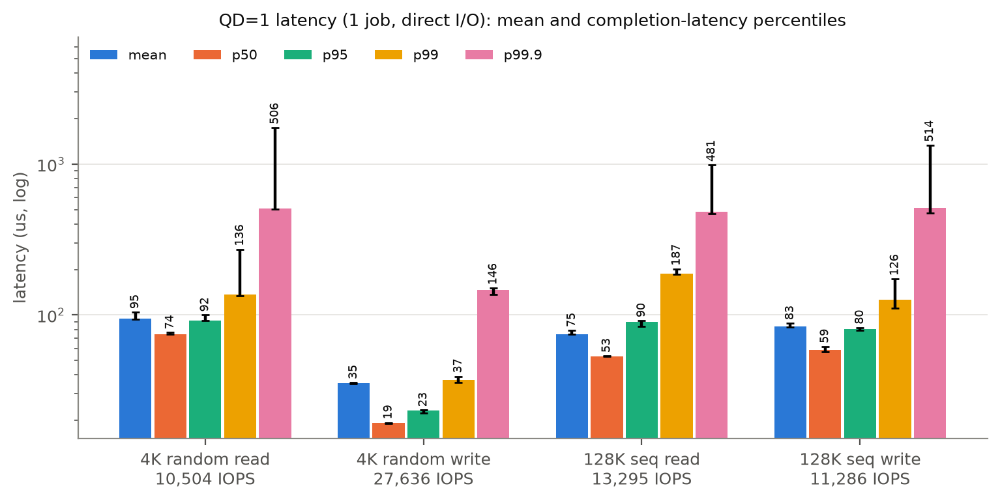
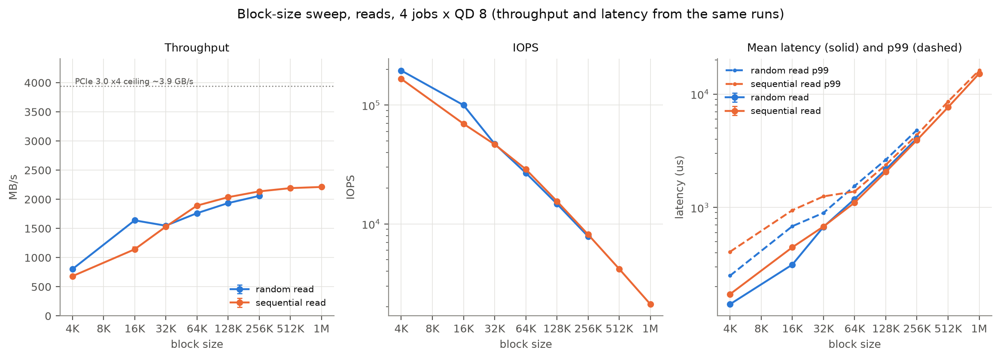
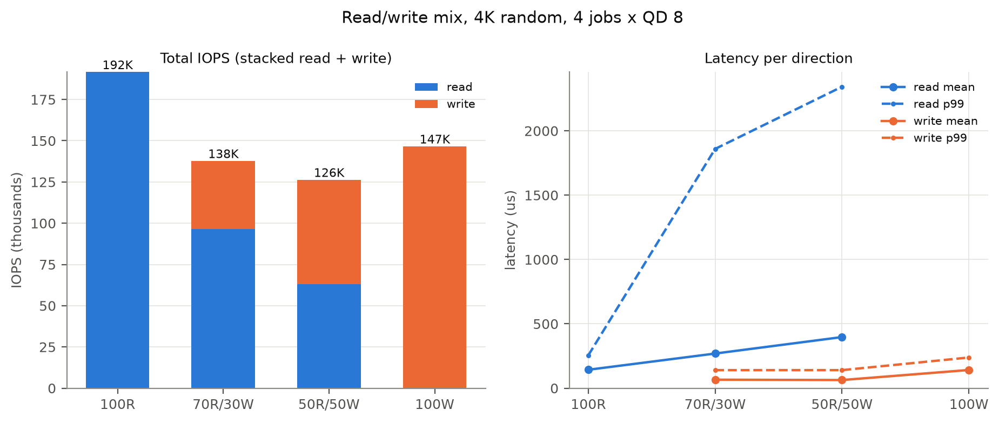
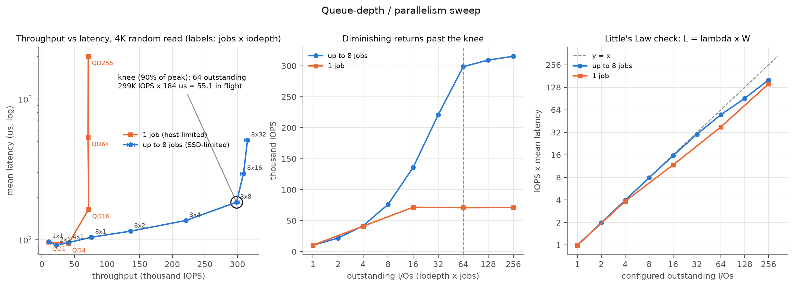
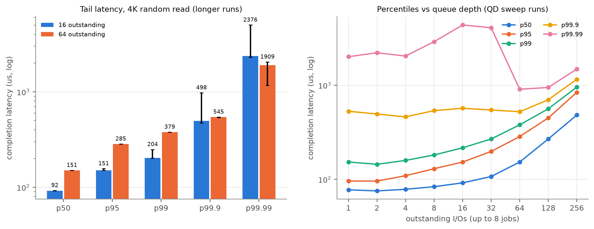
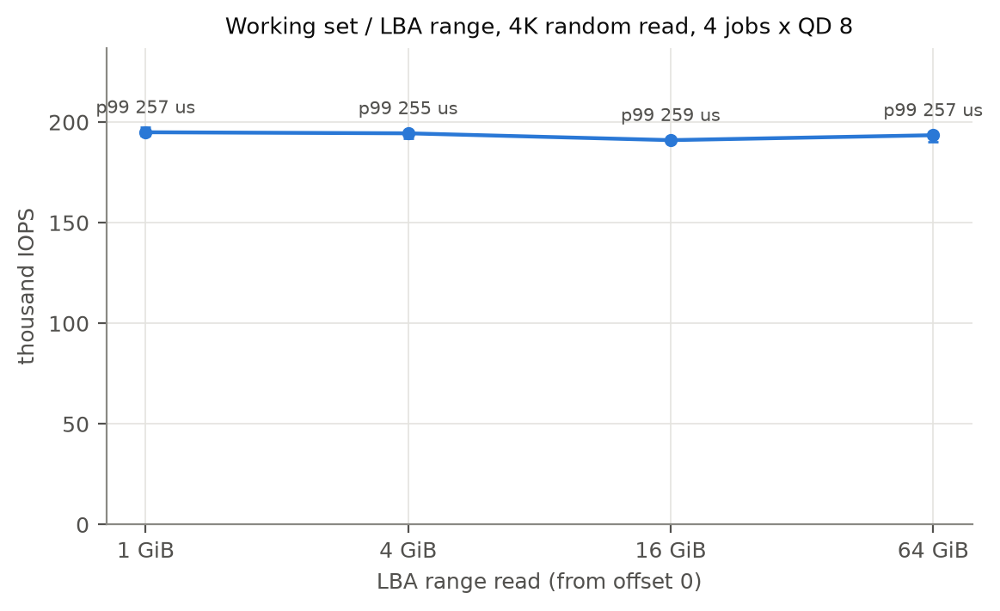
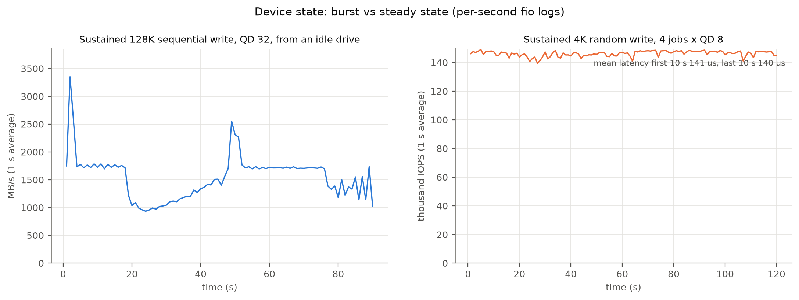
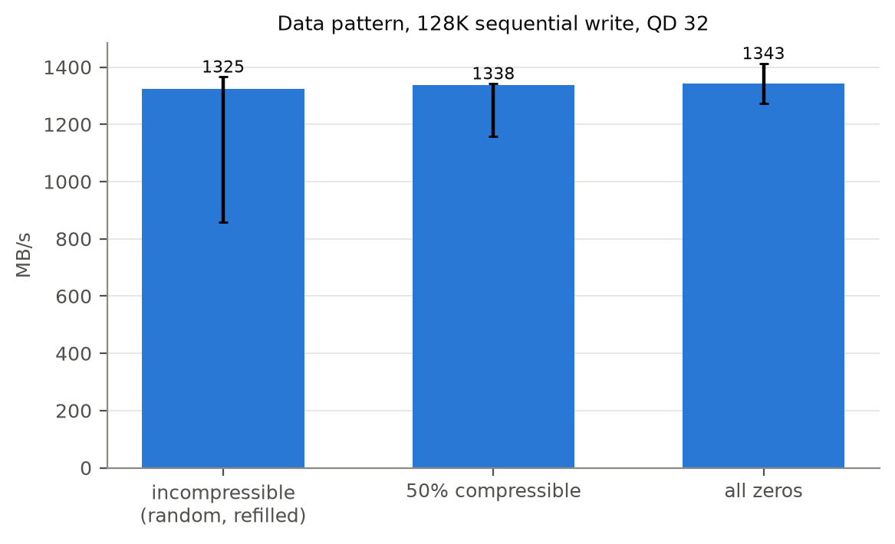
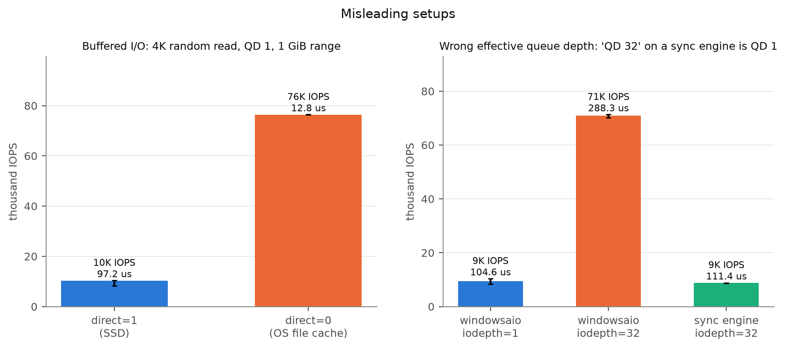

# Project 3 Report: SSD Performance Profiling

ECSE 4320/6320 Advanced Computer Systems · Fall 2026

## Summary

I profiled a Samsung 970 EVO Plus 1 TB NVMe SSD (PCIe 3.0 ×4) with fio 3.43 on Windows 10. All I/O went to a single 64 GiB test file with direct I/O, on a drive separate from the OS.

- **Writes are faster than reads at queue depth 1 -** 4 KiB random reads take 94.5 µs on average (74 µs median), but writes take only 35 µs, because the drive acknowledges a write as soon as it reaches its internal buffer.
- **The throughput–latency knee is at 64 outstanding I/Os -** 299K IOPS at 184 µs. Doubling to 128 adds only 3.5% IOPS for 60% more latency.
- **A single fio job can't test this SSD -** One submission thread tops out at \~71K IOPS and shows its own "knee", which has nothing to do with the drive. Spreading the load over up to 8 jobs reveals the real limit.
- **Mixing reads and writes hurts reads -** At 50/50, read latency is 2.8× its pure-read value (p99 2.3 ms vs 255 µs), while writes stay at \~63 µs.
- **The fast write cache runs out in seconds -** Sustained writes burst to 3.35 GB/s for \~2 s, then settle at \~1.7 GB/s, because the drive was 87% full.
- **Misleading setups are easy -** Buffered I/O reports 7.5× the real IOPS, and a synchronous engine set to queue depth 32 actually runs at queue depth 1.

## Rubric map

| Rubric category (points) | Where |
|---|---|
| Safety and zero-queue baselines (30) | §2.1, §3 |
| Block-size and pattern sweeps (35) | §4 |
| Read/write and queue-depth analysis (40) | §5, §6 |
| Tail latency and device state (25) | §7, §8 |
| Reproducibility and data hygiene (25) | §2, §12 |
| AI-use transparency and pitfall analysis (15) | §9, §11 |
| Report quality (15) | figures throughout, §10, §13, §14 |

---
## 1. Pre-experiment hypotheses

1. **Read latency at queue depth 1 should be roughly the flash read time plus overhead -** about 60–90 µs for 4 KiB. Writes should be faster, since they are buffered.
2. **Larger blocks should raise MB/s and lower IOPS -** with throughput levelling off near the interface limit (\~3.5 GB/s on the datasheet).
3. **IOPS should grow with queue depth until the drive's internal parallelism is used up -** then latency should rise with no extra throughput. I expected the knee around 32–64.
4. **Mixed workloads should get fewer total IOPS than either pure one -** and reads should suffer most, since they can get stuck behind slow flash writes.
5. **Sustained writes should slow sharply once the fast cache fills -** while LBA range and data compressibility shouldn't matter for this drive.

## 2. System and methodology

| Item | Value |
|---|---|
| SSD | Samsung 970 EVO Plus 1 TB, firmware 2B2QEXM7, NVMe, PCIe 3.0 ×4, TLC flash with an SLC write cache |
| Drive state | D: (whole disk), NTFS; **117 GB free of 931 GB** (87% full) during the runs |
| Host | AMD Threadripper 2920X; Windows 10 Home 22H2; Ultimate Performance power plan; hypervisor off |
| OS drive | C:, a separate physical SSD, so OS activity doesn't touch the drive under test |
| Tool | fio 3.43, `windowsaio` engine, `direct=1`, incompressible data |
| Target | one **64 GiB file**, `D:\ssdbench\fio_test.dat`, filled before testing |
| Timing | 20 s per job after a 3 s warm-up (tail jobs 60 s); **3 runs** per configuration |
| CPU placement | fio threads pinned to physical cores 1–8; core 0 left for interrupts |

Plots show the **median of 3 runs** with min–max error bars. Every fio job file is saved in `configs/`, fio's raw output in `data/raw/`, and the environment record in `data/raw/env.txt`.

### 2.1 Data safety

D: holds \~750 GB of my real files, so all testing happens **inside one file**. The file system keeps files separate, so jobs on that file can't touch any other file. Before fio starts, `run_all.ps1` checks each job and refuses to run unless:
- it names **exactly one file, the test file**;
- it uses **no raw-device paths** (the one fio setting that can wipe a drive);
- it uses **direct I/O**, except one marked pitfall job that only reads.

The script also rejects any test path outside `D:\ssdbench\` and keeps at least 100 GB free on D:. The whole project wrote a few hundred GB, well under 0.1% of the drive's 600 TB write rating.

### 2.2 Preconditioning
The whole test file is written once before testing. Reading never-written areas returns zeros without touching flash, which would overstate read speed.

---

## 3. Zero-queue (QD = 1) baselines



*Figure 1. Latency at queue depth 1 for 4 KiB random and 128 KiB sequential reads and writes.*

| Workload (QD 1) | Mean | p50 | p95 | p99 | IOPS | MB/s |
|---|---|---|---|---|---|---|
| 4 KiB random read | 94.5 µs | 74.2 | 91.6 | 136 | 10.5K | 43 |
| 4 KiB random write | **35.2 µs** | 19.3 | 23.2 | 37.1 | 27.6K | 113 |
| 128 KiB sequential read | 74.5 µs | 53.0 | 89.6 | 187 | 13.3K | 1,743 |
| 128 KiB sequential write | 83.5 µs | 58.6 | 80.4 | 126 | 11.3K | 1,479 |

- **Every random read pays a flash read -** \~74 µs median, within the 60–90 µs I expected (hypothesis 1).
- **Random writes finish in 19 µs -** The drive acknowledges a write once it's in its buffer and writes the flash later.
- **Sequential 128 KiB reads beat random 4 KiB reads** (53 vs 74 µs median) despite moving 32× more data. Large reads are split across many flash chips at once.
- **The mean is above the median everywhere -** Rare slow requests pull it up (§7).

## 4. Block-size and pattern sweep



*Figure 2. Reads with 32 outstanding I/Os: throughput, IOPS, and latency from the same runs, random vs sequential.*

| Block | Random MB/s | Random IOPS | Sequential MB/s | Sequential IOPS | Mean latency (seq) |
|---|---|---|---|---|---|
| 4 KiB | 802 | 196K | 681 | 166K | 172 µs |
| 16 KiB | **1,639** | 100K | 1,142 | 70K | 446 µs |
| 64 KiB | 1,762 | 27K | 1,892 | 29K | 1.11 ms |
| 256 KiB | 2,059 | 7.9K | 2,136 | 8.1K | 3.93 ms |
| 1 MiB | — | — | **2,212** | 2.1K | 15.2 ms |

- **Small blocks are limited by IOPS, large blocks by bandwidth -** Above 32 KiB, IOPS halves with each doubling of block size while MB/s levels off near 2.2 GB/s. Latency then grows in proportion to block size (Little's Law: 32 × 1 MiB ÷ 2.2 GB/s ≈ 15 ms, measured 15.2 ms). Hypothesis 2 held in shape.
- **Random beats sequential at 4–16 KiB -** Small sequential reads tend to land on the same flash chip and queue up behind each other, while random reads spread across all chips at once.
- **Anomaly: reads level off at 2.2 GB/s, not the datasheet's 3.5 GB/s -** The link isn't the limit, because writes reached 3.35 GB/s (§8). The leading suspect is heat: an earlier, aborted run logged **80 °C** after only the first section. The final run couldn't log temperature, so I can't confirm it.

## 5. Read/write mix



*Figure 3. 4 KiB random, 32 outstanding I/Os. Left: total IOPS by direction. Right: mean and p99 latency per direction.*

| Mix (read %) | Read IOPS | Write IOPS | Total | Read mean / p99 | Write mean |
|---|---|---|---|---|---|
| 100 / 0 | 192K | — | **192K** | 143 µs / 255 µs | — |
| 70 / 30 | 96K | 41K | 138K | 269 µs / 1.86 ms | 66 µs |
| 50 / 50 | 63K | 63K | **126K** | **397 µs / 2.34 ms** | 63 µs |
| 0 / 100 | — | 147K | 147K | — | 142 µs |

- **Any mix is worse than either pure workload -** Total IOPS drops 34% from pure read to 50/50. Hypothesis 4 held.
- **Reads take the penalty, writes don't -** Writes are still acknowledged from the buffer (\~63 µs), but a read that lands on a flash chip busy writing must wait. Read p99 jumps 9×.
- **The 70/30 mix varied a lot between runs** (89K–125K read IOPS), probably because the drive's background cleanup was in a different state each time.

## 6. Queue-depth sweep, knee, and Little's Law



*Figure 4. 4 KiB random read. Left: latency vs IOPS (labels = jobs × queue depth). Middle: IOPS vs outstanding I/Os. Right: Little's Law check.*

**Design:** Total outstanding I/Os = jobs × queue depth, swept from 1 to 256 with up to 8 jobs. A second sweep uses one job only, for comparison.

| Outstanding I/Os | IOPS | Mean latency | p99 | IOPS × latency |
|---|---|---|---|---|
| 1 | 10.2K | 97 µs | 153 µs | 0.99 |
| 16 | 136K | 115 µs | 216 µs | 15.6 |
| 32 | 221K | 137 µs | 268 µs | 30.2 |
| **64** | **299K** | **184 µs** | 379 µs | **55.1** |
| 128 | 309K | 296 µs | 561 µs | 91.2 |
| 256 | 315K | 510 µs | 954 µs | 160.9 |
| *1 job, QD 256* | *71K* | *2,008 µs* | — | *142.8* |

- **The knee (first point at 90% of peak) is at 64 outstanding: 299K IOPS at 184 µs -** Below it, throughput grows almost linearly. Past it, 64 → 128 adds 3.5% IOPS for +60% latency: the drive's internal parallelism is used up, and extra requests just wait. Hypothesis 3 held.
- **Little's Law holds up to 16 outstanding, then falls short -** IOPS × latency should equal the number of outstanding I/Os. It's within 2% up to 16 but only 55 at 64. Fewer I/Os are really in flight than configured, because each fio thread handles completions in batches, and meanwhile some of its I/Os wait on the host side.
- **One job is limited by the host, not the SSD -** A single thread tops out at **\~71K IOPS**. Its curve shows a perfect-looking knee at QD 16, but that knee is one CPU thread's limit (§9).

## 7. Tail latency



*Figure 5. Latency percentiles at mid queue depth (16) and near the knee (64), 60 s runs.*

| Outstanding | p50 | p95 | p99 | p99.9 | p99.99 (range of 3 runs) |
|---|---|---|---|---|---|
| 16 | 92 µs | 151 | 204 | 498 | 2.4 ms (2.3–5.0) |
| 64 | 151 µs | 285 | **379** | 545 | 1.9 ms (1.2–2.1) |

- **Up to p99, the whole distribution shifts with queueing -** p50 rises 1.6× and p99 1.9× from 16 to 64 outstanding.
- **The rarest delays don't depend on queue depth -** p99.99 is about 2 ms at both depths, with a wide spread between runs. These come from occasional internal events (background cleanup, a read stuck behind a flash erase, or Windows interrupts), not from queueing.
- **For latency-sensitive use, stay below the knee -** At 16 outstanding the drive gives 46% of peak IOPS at about half the p99 latency.

## 8. LBA range and device state



*Figure 6a. 4 KiB random reads restricted to the first 1, 4, 16 or 64 GiB of the file.*

**LBA range has no effect -** 191K–195K IOPS at every range, within run-to-run spread. The drive has enough DRAM to hold its whole address map, so a random read never needs an extra lookup. Hypothesis 5 held.



*Figure 6b. Left: sustained 128 KiB sequential write after 120 s idle. Right: sustained 4 KiB random write, 120 s.*

- **Burst, then cache exhaustion -** Sequential writes burst to **3.35 GB/s** for about 2 s (\~7.7 GB), then settle at **\~1.72 GB/s**, Samsung's specified speed for writing straight to the slower TLC flash. The burst is short because the drive's extra cache space comes from free space, and the drive was 87% full.
- **A mid-run dip to \~0.95 GB/s (19–48 s) is unexplained -** The run starts overwriting its own file after \~38 s, which forces cleanup work; heat is the other candidate.
- **Random writes stayed flat at 146K IOPS for 120 s -** No slowdown appeared in that window. A true steady state would need the whole drive written several times over, which I didn't do (§13).



*Figure 8. 128 KiB sequential write by data pattern.*

**Data pattern doesn't matter for this drive -** Incompressible, half-compressible and all-zero data all wrote at \~1.33 GB/s. Samsung's controller doesn't compress data.

## 9. Misleading setups (pitfalls)



*Figure 7. Left: buffered vs direct I/O. Right: windowsaio at queue depth 1 and 32 vs a synchronous engine set to queue depth 32.*

| Setup | Reported | Reality | Error |
|---|---|---|---|
| **Buffered I/O**, 4 KiB random read over 1 GiB | 76.4K IOPS, 12.8 µs | 10.2K IOPS, 97 µs (direct I/O) | **7.5× too fast**: the OS file cache was measured |
| **Synchronous engine** with queue depth 32 | 8.8K IOPS | the same as queue depth 1; real QD 32 gives 71K | queue depth silently ignored |
| **One fio job** for the queue-depth sweep | knee at \~71K IOPS | 299K with 8 jobs | a CPU thread's limit reported as the SSD's |

The single-job mistake is the one my own first test run made (§11).

## 10. Anomalies

- **Sequential reads level off at 2.2 GB/s** instead of 3.5 GB/s (§4); heat is the leading suspect.
- **Random faster than sequential at 4–16 KiB** (§4), and 32 KiB random slightly below 16 KiB.
- **A dip in the sustained sequential write** (§8).
- **Little's Law shortfall at high queue depth** (§6).
- **The SMART temperature log** contains two rows from an earlier, aborted run (60 °C at start, 80 °C after the first section). The final run was started without admin rights, so it has no temperature data. I kept the rows as they are, since they are the only temperature evidence.

## 11. Design process and AI-use note

### 11.1 Discoveries along the way
- **Safety drove the design -** D: is a separate drive not containing the OS, but is full of my data with no free partition space, which ruled out raw-device tests and led to the single-file design.
- **One fio job can't saturate this SSD on Windows -** The first test levelled off at \~65–70K IOPS no matter the queue depth. Every high-concurrency test now uses up to 8 jobs.
- **Windows quirks -** fio needs the drive letter's colon escaped (`D\:`), synchronous engines refuse direct I/O, and temperature logging needs an admin shell.

### 11.2 AI-use note

**Tool.** Claude Code (Anthropic's AI coding assistant, running in VS Code).

**What it generated:**
- `run_all.ps1` (fio job generation, the safety checks, every experiment section);
- the plotting script `plots/make_plots.py`;
- first draft of project README;
- polished report and translated to a markdown file as I am unfamiliar with the syntax.

**What I did and decided:**
- worked out the approach with Tiffany Cheng and Marie Morales;
- wrote upper-level design for the project that Claude implemented, including the requirement that no real files on D: could be put at risk;
- chose the single-test-file approach and installed fio;
- ran the full data collection (\~75 minutes) myself with D: otherwise idle;
- analyzed and interpreted data from the operations and wrote the initial report.

**AI mistakes and wrong turns, and how they were caught:**

| # | What went wrong | How it was caught / fixed |
|---|---|---|
| 1 | **Host-limited sweep:** the first design used one fio job, so the "knee" was a CPU thread's limit, not the SSD's | The test levelled off far below the drive's spec; the sweep now uses up to 8 jobs, and the 1-job curve is kept as a pitfall |
| 2 | **Bug in the safety check itself:** with a single matching line, PowerShell returned text instead of a list, so the check compared the wrong value and rejected a valid job | Caught on the first run; the check **failed safe** (nothing ran). Fixed |
| 3 | **Unescaped drive letter:** fio read the `:` in `D:\` as a separator, breaking its output | Fixed by escaping it |
| 4 | **Wrong engine settings:** the synchronous-engine pitfall job used direct I/O, which fio on Windows rejects | It was the one job that failed in the first full test; redesigned as a buffered read over the whole file |
| 5 | **Missing temperature data:** logging needs an admin shell, and the final run wasn't started from one | Found while writing this report; listed as a limitation |

**What I validated independently:**
- every number in this report against `data/processed/`;
- Little's Law for every queue-depth point;
- that the safety checks reject bad paths (four tested).

## 12. Reproducibility

```powershell
powershell -ExecutionPolicy Bypass -File .\run_all.ps1           # ~75 min; admin shell adds temperature logging
powershell -ExecutionPolicy Bypass -File .\run_all.ps1 -Quick    # short smoke test
py -3.12 plots\make_plots.py                                     # data\processed\ + plots\
Remove-Item -Recurse D:\ssdbench                                 # delete the test file when finished
```

The exact fio job files are in `configs/`, fio's raw output in `data/raw/`, and the parsed tables in `data/processed/`.

## 13. Limitations

- **No temperature for the final run -** Heat can't be confirmed or ruled out for the 2.2 GB/s read limit and the write dip.
- **A file, not the raw device -** The Windows file system adds a little latency, and on a nearly full drive the file may not sit in one contiguous region.
- **Not a true steady state -** That would need the whole drive written several times, costing hours and significant wear on a drive with real data.
- **The drive was 87% full -** which shrinks its write cache; results describe this drive in this state.
- **Windows-specific limits -** One fio thread caps at \~71K IOPS; Linux I/O engines go higher.

## 14. Conclusions

1. **Queueing explains most of the curve.** Throughput grows with outstanding I/Os until the drive's parallelism is used up (knee at 64, \~299K IOPS); past that, Little's Law predicts the added latency.
2. **Latency depends on where the data actually goes.** Writes are acknowledged from the buffer (19 µs), reads pay the flash read (74 µs), and in a mix, reads wait behind writes.
3. **Device state matters.** The fast write cache lasted \~2 s on an 87%-full drive, and the rarest delays come from internal events, not queueing.
4. **Most misleading results come from the host, not the SSD.** Buffered I/O, an ignored queue depth and a single submission thread each produced a confident but wrong number.
